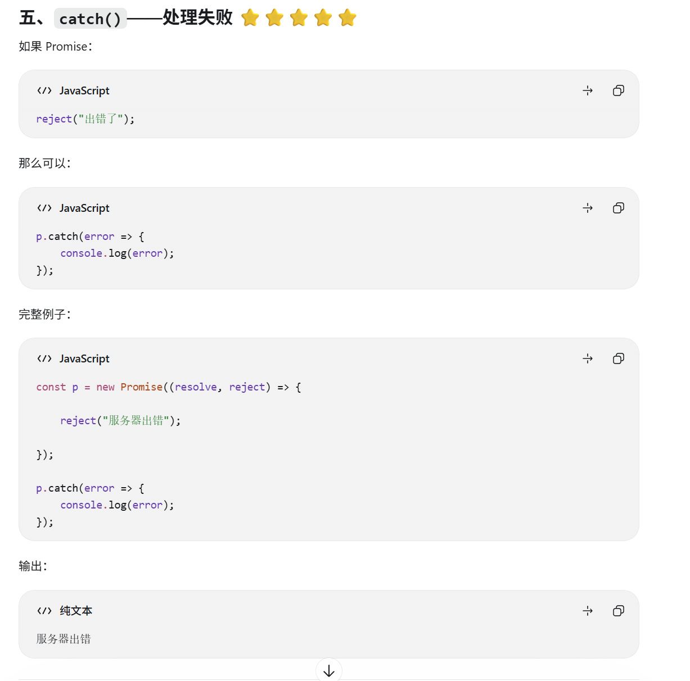
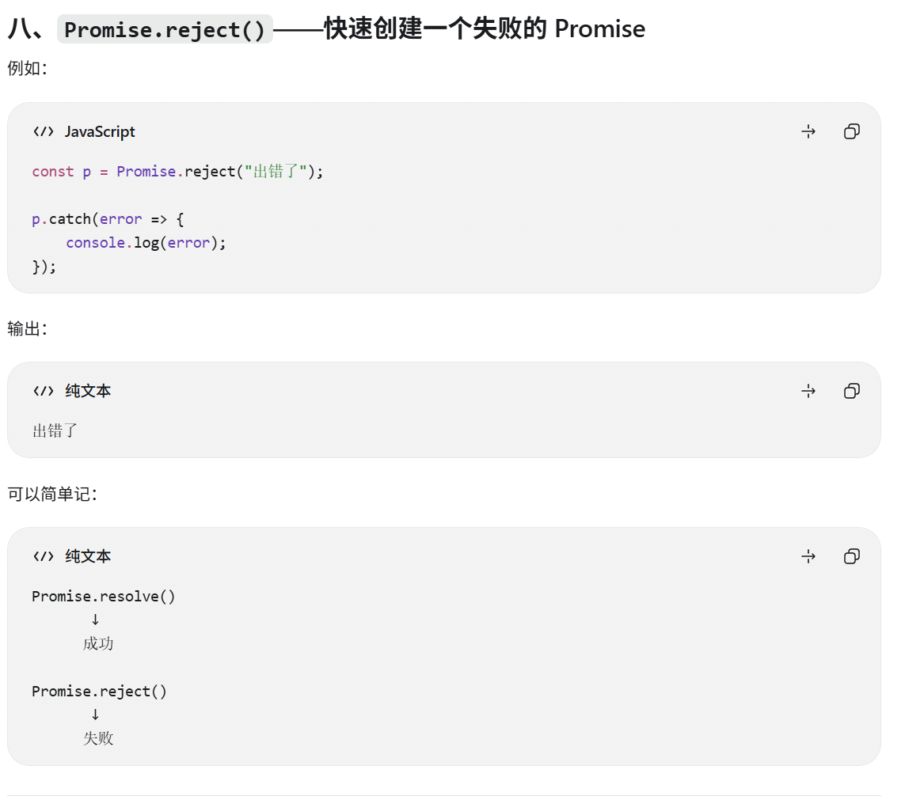
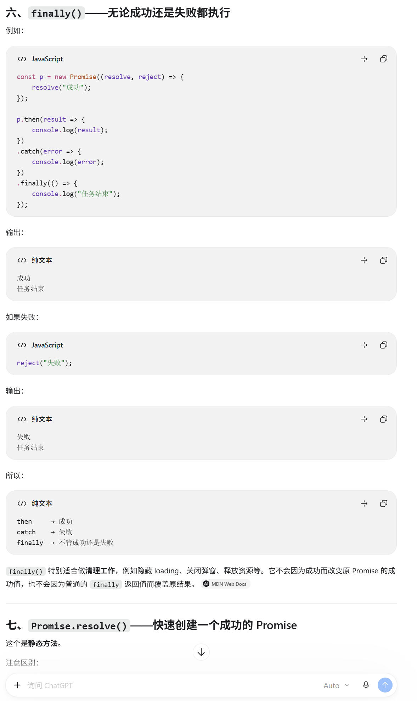
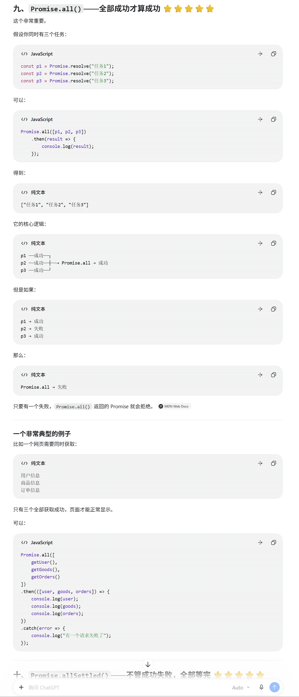
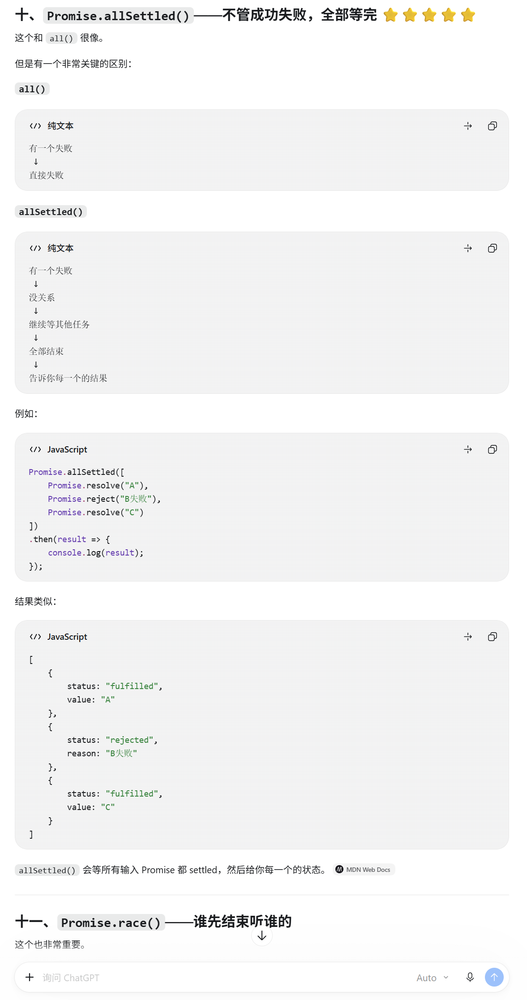
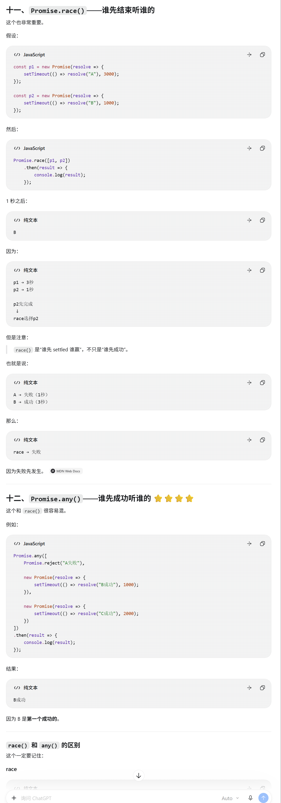

# ES6介绍

## ES6新特性

- let和const命令

- es6的模版字符串

- 增强的函数

- 扩展的字符串，对象，数组功能

- 解构赋值

- Symbol

- Map和Set

- 迭代器和生成器

- Promise对象

- Proxy对象

- async的用法

- 类class

- 模块化实现

## 1. let和const命令

##### var产生的变量提升

> JS 在执行代码之前，会先处理变量和函数的声明。

- 注意：**“提升”不是把代码真的移动到最上面**，而是 JS 在执行前，会先建立好变量、函数等的相关信息。

- var会产生覆盖

```var
console.log（a）;
var a = 2;
```

```会变成下面这个样子，产生变量提升，控制台打印undefined
var a;
console.log(a);
a = 2;
```

```var声明的变量会产生覆盖，此时输出4
var a = 2
var a = 4
console.log(a)
```

##### let声明变量没有变量提升

- 是一个块作用域

- let不能重复声明

- let必须先声明后使用

```let
console.log(a)
let a = 10
```

```是一个块作用域，此时会直接报错
if(1===1){
    let b = 10;
}
console.log(b);
```

```let不能重复声明，这样写会报错
let a = 1
let a = 3
console.log(a)
```

##### const声明常量，声明后无法改变

- const也没有变量提升

- const和let特性差别不大

- const声明的常量必须赋初始值，let可以不赋初始值

- const声明的对象，不能修改常量对象但可以修改对象的内部属性

```const声明之后无法改变，下修改后会报错
const max = 30
max = 40
console.log(max)
```

```const可以修改常量对象的属性
const person = {
    name:'小马哥'
}
person.name = 'alex'
console.log(person)
```

```const不可以直接修改常量对象，这时会报错
const person = {
    name:'小马哥'
}
person = {
    age:20
}
console.log(person)
```

>  建议：在默认情况下用const，而只有在你知道变量值需要被修改的情况使用let

## 2.模版字符串

##### 模版字符串：使用tab键上面的反引号``，插入变量时使用${变量名}

> 简单代码实现

```
<body>
    <div class="box">

    </div>
    <script>
        const oBox = document.querySelector('.box')
        let id = 1,name = '小马哥'
        let htmlStr = `<ul>
            <li>
                <p id = ${id}>${name}</p>
            </li>
        </ul>`
        oBox.innerHTML = htmlStr
    </script>
</body>
```

##### 字符串新增的方法

```
{
    #1.includes() 判断是否包含，返回true/false
    let str = `hello world`
    console.log(str.includes(`h`)) #true
    console.log(str.includes(`yy`)) #false
}
{
    #2.startsWith() 判断字符串是否是在原字符串的头部，返回true/false
    let str = `hello world`
    console.log(str.includes(`h`)) #true
    console.log(str.includes(`e`)) #false
}
{
    #3.endsWith() 判断字符串是否是在原字符串的结尾，返回true/false
    let str = `hello world`
    console.log(str.includes(`world`)) #true
    console.log(str.includes(`hello`)) #false
}
{
    #4.repeat() 将字符串重复n次，返回重复后的新字符串
    let str = `hello world`
    console.log(str.repeat(3))
    #hello worldhello worldhello world
}
```

## 3.强大的函数

##### 带参数默认值的函数

> 简单代码实现

```此时30会赋值给a,返回结果为50
function add(a,b = 20){
    return a + b;
}
console.log(add(30))
```

##### 默认的表达式也是一个函数

> 简单代码实现

```此时代码返回20
function add(a,b = getVal(5){
    return a + b;
}
function getVal(val){
    return val + 5;
}
console.log(add(10))
```

##### 剩余参数问题：由三个点（...）和一个紧跟着的具名参数指定

例如：...keys

> ...keys解决了arguments的问题，...keys取的是对象的真实数组，arguments取的是伪数组

```最后输出name和years
#obj对应的是book，
function pick(obj,...keys){
    #创建一个空对象
    let result = Object.create(null)
    #利用循环将所需要的值付给result
    for(let i=0;i<keys.length;i++){
        result[keys[i] = obj[keys[i]]
    }
    return result;
}

let book = {
    title:'ES6的教程'，
    name：'小马哥'，
    years：2019
}
#利用pick函数取出book里的值
let bookData = pick(book,'name','years')
console.log(bookData)
```

##### 扩展运算符(...)

> 剩余运算符：把多个独立的数组合并到一个数组中
> 
> 扩展运算符：将一个数组分割，并将各个项作为分离的参数传给函数

```处理数组中的最大值
const arr = [10,20,30,40,50,90,100]
#利用Math.max求最大值
console.log(Math.max(...arr))
```

##### ES6的箭头函数（重要）

> 使用 => 来定义   function(){} 等同于 ()=>{}

```用function和用箭头函数对比，箭头函数更加简洁
{
    #function写法
    function fn(){
        return 99;
    }
    let fn2 = function(){
        return 99;
    }
}

{
    #1.初体验
    let fn = () => {
        return 99;
    }
    let fn2 = () => 99;
    console.log(fn())
    console.log(fn2())
}
```

```其他箭头函数的简便写法
{
    #2.常用的场景
    let person = {
        fn(){
            setTimeout(()=>{
                console.log(1)
            },1000)
        }
    }
    person.fn()

    let arr = ['zhangsan','lisi','wangwu']
    arr.forEach((item)=>{
        console.log(item)
    })
}
{
    #3.有参函数和无参函数定义
    #如果函数体只有return一行代码，=>直接写要返回的内容
    #无参
    let fn = ()=>99
    #有参
    let fn2 = (a,b) => a+b
    console.log(fn2(10,20))
}
{
    #4.如果函数体有多行(如果有返回值，需要手动return)
    let fn = ()=>{
        console.log('a')
        console.log('b')
        return 99
    }
    console.log(fn())
}
{
    #5.如果返回值就是一个{}对象，需要用()包裹起来
    let fn = ()=>({name:'zhangsan'})
    console.log(fn())
}
```

##### 箭头函数中this的指向

```
{
    #6.1函数体的this是指的定义时的对象
    document.getElementById("box").onclick = ()=>{
        console.log('box点击'，this，this.innerHTML)
        #指向window
    }
}
{
    #6.2不可以用作构造函数
    function Person(name){
        this.name = name;
    }
    let p = new Person('lisi')
    console.log(p)

    let Person2 = (name)=>{
        this.name = name
    }
    let p2 = new Person2('wangwu')#报错
}
{
    #6.3不可以使用arguments对象
    #箭头函数用rest参数 ...
    function fn(){
        console.log(arguments)
    }
    fn(10,20,30)

    let fn2 = (...args)=>{
        #console.log(arguments)报错
        console.log(args)
    }
    fn2(40,50,60)
}
{
    #6.4不可以使用yield命令，因此箭头函数不能用作Generator函数
}
```

##### 函数的this指向

> ES5中this指向：取决于调用该函数的上下文对象
> 
> ES6中箭头函数没有this指向，箭头函数的内部this值只能通过查找作用域链来确定

> 箭头函数注意事项：1.使用箭头函数 函数内部没有arguments
> 
> 2.箭头函数不能使用new关键字来实例化对象

```一般写法，this指向window
{
    #普通函数  一般写法，this指向window
    function fn(){
        console.log(this);#Window
    }
    fn();
}
{
    #构造函数  this指向new的对象Person
    function Person(name){
        this.name = name
        console.log(this)
    }
    let Person = new Person('zhangsan')
    console.log(person)
}
{
    #作为对象属性  this指向当前的对象
    let obj = {
        name:'zhangsan',
        fn(){
            console.log(this,this.name)
        }
    }
    obj.fn()
}
```

* 修改对象内this指向
  
  * obj.call(要指向的对象，参数1，参数2......)                会执行
  
  * obj.apply(要指向的对象，[参数1，参数2......])          会执行
  
  * obj.bind(要指向的对象)                                         返回对应的函数

```
{
    #作为对象中的属性
    let obj = {
        name:'zhangsan',
        fn(){
            console.log(this,this.name)
        }
    }
    obj.fn.call({name:'lisi'})
    obj.fn.apply({name:'wangwu'})
    let fn = obj.fn.bind({name:'zhaoliu'})
    fn()
}
```

## 4.解构赋值

* 解构：只需要保证左右两边的结构一致即可

* 数组解构和对象解构的不同：数组解构是按照顺序一一解构，对象结构与顺序无关，根据属性名和变量名进行比较

> 解构赋值是对赋值运算符的一种扩展，它针对数组和对象来进行操作。优点：代码书写上简洁易读

```输出iden，foo
#对象解构
{
    #1.完全解构
    let obj = {name:'zhangsan',age:20}
    let {name,age} = obj
    console.log(name,age)#输出zhangsan 20
}
{
    #2.部分解构
    let obj = {name:'zhangsan',age:20}
    let{age} = obj
    console.log(age)#输出20

    let {address,name} = obj
    console.log(address,name)#如果没有匹配到变量值，输出undefined
}
{
    #3.解构之后重命名
    let obj = {name:'zhangsan',age:20}
    let {name:myname,age:myage} = obj
    console.log(myname,myage)
}
{
    #4.剩余运算符对象解构 -浅拷贝 ...
    let obj = {name:'zhangsan',age:20,address:'天河区'}
    let {name,...rest} = obj
}
{
    #5.对象默认值
    let obj = {name:'zhangsan',age:20,address:'天河区'}
    let {name，img = 'aaa.png'} = obj
    console.log(name,img)
}


#对数组进行解构
{ 
    #1.完全解构
    let a,b;
    [a,b] = [1,2];
    console.log(a,b);#得到1,2
}
{
    #2.不完全解构
    let[a] = [1,2,3]
    console.log(a);#得到1

    let[b,c] = [1]
    console.log(b,c)#得到1，undefined
}
{
    #3.忽略方式解构
    let[,,a] = [1,2,3]
    console.log(a)#得到3
}
{
    #4.嵌套解构
    let[a,b,[c]] = ['a','b',['c']]
    console.log(a,b,c)#得到a,b,c
}
{
    #5.剩余运算符方式解构
    let[a,...b] = [1,2,3,4,5,6,7]
    console.log(a,b)#得到1,2~7
}
{
    #6.解构默认值、
    let[a,b=100] = [90]
    console.log(a,b)#得到90,100
}


#字符串解构
{
    let str = 'qwert'
    let [a,b,c,d] = str
    console.log(a,b,c,d)

    let {length} = str
    console.log(length)
}
```

## 5.扩展的对象功能

> ES6允许我们直接写入变量和函数，作为对象的属性和方法

```利用了ES6的简写方法，这是对象的简写，属性和函数都简写了，调用函数输出小马哥
const name = '小马哥'，age = 20;
const person = {
    name,
    age,
    sayName(){
        console.log(this.name)
    }
}
person.sayName();
```

```输出{x:10，y:20}
function fn(x,y){
    return {x,y};
}
console.log(fn(10,20))
```

```符合if条件判断，throw
let cart = {
    wheel:4;
    set(newVal){
        if(newVal < this.wheel){
            throw new Error('轮子数太少了')
        }
        this.wheel = newVal
    }，
    get(){
        return this.wheel
    }
}
cart.set(6)
console.log(cart.get())
```

```输出{isShow：true，abc:123,fa:f}
const name = 'a'
const obj = {
    isShow:true,
    [name+'bc']:123,
    ['f' + name](){
        console.log(this)
    }
}
console.log(obj)
```

##### 对象的方法

> is() 等价于 === :用来比较两个值是否严格相等。但是 === 有个问题是无法比较NaN是否相等，is()可以进行比较
> 
> assign() 用于对象的合并（重要）

```is()与===的区别对比
#输出false
console.log(NaN === NaN)
console.log(Object.is({},{}))
#输出true 
console.log(Object.is(NaN,NaN))
```

```输出为{a:1,b:2},assign()用于对象的合并
#assign() 用于对象的合并
#如果不希望更改原对象，第一个参数可以给一个{}
let newObject = Object.assign({},{a:1},{b:2})
console.log(newObject)
#合并时如果存在相同属性，后面对象的属性值会覆盖前面对象的属性值
let a = {name:'zhangsan',width:100}
let b = {age:20,width:200}
let ret = Object.assign({},a,b)
console.log(ret)
console.log(a,b)
```

## 6.Symbol（ES6提供的新数据类型）

> 原始数据类型Symbol，它表示是独一无二的值
> 
> 最大的用途：用来定义对象的私有变量

```输出false，Symbol表示独一无二的值
const name = Symbol('name')
const name2 = Symbol('name')
console.log(name === name2)
```

```
let s1 = Symbol('s1')
console.log(s1)
let obj = {}
obj[s1] = '小马哥'
#如果用Symbol定义的对象中的变量，取值时一定要用[变量名]
console.log(obj[s1])
#不能使用console.log(obj.s1)来进行取值
```

## 7.Map和Set

##### Set集合数据类型

> 集合：表示无重复的有序列表

```
{
    #初始化 创建Set
    let list = new Set()
    #添加成员
    list.add('a')
    list.add('b')
    list.add('a')#不报错，但也加不进去
    console.log(list)
}
{
    let arr = ['a','b','c','d','a']
    console.log(arr)
    #初始化 创建Set
    let list = new Set(arr) #也是数组去重的方式之一
    console.log(list)
    #set的大小: size属性
    console.log(list.size)
}
{
    let arr = ['a','b','c','d']
    let list = new Set(arr)
    #判断是否存在 has()
    console.log(list.has('aa'))
    #如果有c 则进行删除
    if(list.has('c')){
        console.log('del',list.delete('c'))
    }
    #完全删除
    list.clear()
    console.log(list)
}
{
    let arr = ['张三','李四','王五','赵六']
    let list = new Set(arr)
    #键值对
    list。forEach(function(k,v,itemlist)){
        console.log('forEach:',k,v,itemlist)
    }
}
```

##### Map类型（键值对的有序列表）

> 建和值可以是任意的类型

```
let map = new Map()
#创建一个键值对
map.set('name','张三')
map.set('age',20)
#获取map里面的值
console.log(map.get('name'))
console.log(map)
#校验
map.has('name')
#删除
map.delete('name')
#直接清除
map.clear()
console.log(map)

#键可以是任意类型
map.set(['a',[1,2,3]],'hello')
console.log(map)
```

```另一种写法,输出a:1,c:2
let m = new Map([
    ['a',1],
    ['c',2]
])
console.log(m)
```

## 8.数组的扩展功能

##### 数组的两种方法：from(), of()

> Array.from()可以将伪数组转换成真正的数组,扩展运算符可以将伪数组转换成真正的数组

```
function add(){
    console.log(arguments)
    #ES5转换(不好理解)
    let arr = [].slice.coll(arguments)

    #ES6写法
    let arr = Array.from(arguments)
    console.log(arr)
}
add(1,2,3)
```

> Array.from()还可以接受第二个参数，用来对每个元素进行处理

```
let liContents = Array.from(lis,ele => ele.textContent)
console.log(liContents)
```

> Array.of() 可以将将任意的数据类型，转换成数组

```
console.log(Array.of(3,11,20,[1,2,3],{id:1}))
```

##### copywithin(),find(),findIndex()三种方法解析

> copywithin() 数组内部将指定位置的元素复制到其他的位置，返回当前数组
> 
> 从3位置往后的所用数值，替换从0位置往后的三个数值

```
console.log([1,2,3,8,9,10].copyWithin(0,3))
#输出[8,9,10,8,9,10]
```

> find() findIndex()
> 
> find() 找出第一个符合条件的数组成员

```输出-10
let num = [1,2,-10,-20,9,2].find(n => n < 0)
console.log(num)
```

> findIndex() 找出第一个符合条件的数组成员索引

```输出2
let numIndex = [1,2,-10,-20,9,2].findIndex(n => n < 0)
console.log(numIndex)
```

##### entries(),keys(),values() 返回一个遍历器 可以使用for...of循环进行遍历

> keys() 对键名遍历
> 
> values() 对值遍历
> 
> entries() 对键值对遍历

```
#输出0,1
for (let index of ['a','b'].keys()){
    console.log(index)
}
#输出a,b
for (let ele of ['a','b'].values()){
    console.log(ele)
}
#输出0 'a'  1 'b'
for (let [index,ele] of ['a','b'].entries()){
    console.log(index,ele)
}
```

##### includes() 返回一个布尔值，表示某个数组是否包含给定的值

> 存在时返回true，不存在时返回false

```
console.log([1,2,3].includes(2))
console.log([1,2,3].includes('4'))
```

* 之前使用indexOf进行判断，存在时返回1，不存在时返回-1，之后还要进行完全相等判断输出true或false，明显没有上面的方便

## 9.迭代器Iterator的用法

##### Iterator是一种遍历机制，有两个核心

* 1.迭代器是一个接口，能快速的访问数据，通过Symbol.iterator来创建迭代器，通过迭代器的next()获取迭代之后的结果

* 2.迭代器是用于遍历数据结构的指针(数据库的游标)

```
#使用迭代
const items = ['one','two','three']
const ite = items[Symbol.iterator]()
#第一次返回结果为{value:'one',done:false} done如果为false表示
遍历继续 如果为true表示遍历完成
console.log(ite.next())
console.log(ite.next())
console.log(ite.next())
console.log(ite.next())
```

## 10.生成器Generator的用法

##### generator函数

* 可以通过yield关键字，将函数挂起，为了改变执行流提供了可能，同时为了做异步编程提供了方案

##### 它与普通函数的区别

* 1.在function的后面 函数名之前有一个*

* 2.只能在函数内部使用yield表达式，让函数挂起

```
{
    #基本语法 *
    let tell = function *(){
        console.log('1')
        yield;#暂停
        console.log('2')
        yield;
        console.log('3')
    }
    let it = tell()
    #通过next()执行下一步，每当遇到yield会暂停执行
    it.next()
    it.next()
    it.next()
}
{
    #yield 返回值
    let tell = function *(){
        console.log('1')
        yield 'a';
        console.log('2')
        yield 'b';
        console.log('3')
        return 'c'
    }
    let it = tell()
    console.log(it.next()) #{value:'a',done:false}
    console.log(it.next()) #{value:'b',done:false}
    console.log(it.next()) #{value:undefined,done:true}
    #函数添加return后 输出{value:'c',done:true}
}
{
    #yield 传参
    let tell = function *(){
        console.log('1')
        let res1 = yield;
        console.log('2:',res1)
        let res2 = yield;
        console.log('3:',res2)
        return 'c'
    }
    let it = tell()
    it.next(10) #1
    it.next(20) #2:20
    it.next(30) #3:30
}
```

> 总结：generator函数是分段执行的，yield语句是暂停执行，而next() 是恢复执行

## 11.生成器Generator的应用

```
{    
    #需求：使用for...of输出对象属性值
    let obj = {
        name:'zhangsan',
        age:20,
        address:'天河区'
    }
    obj[Symbol.iterator] = function*(){
        yield obj.name
        yield obj.age
        yield obj.address
    }
    for(let i of obj){
        console.log('i:',i)
    }
}
{
    #需求：先A再B再C
    function ajax(url,data){
        return new Promise((resolve,reject)=>{
            resolve(data)
        })
    }
    function *steps(){
        let aaa = yield ajax('/aaa','a参数').then(res=>{
            console.log('aaa的响应结果'，res)
            return it.next('a响应值')
        })
        let bbb = yield ajax('/bbb','b参数').then(res=>{
            console.log('bbb的响应结果'，res,aaa)
            return it.next('b响应值')
        })
        let ccc = yield ajax('/ccc','c参数').then(res=>{
            console.log('ccc的响应结果'，res,bbb)
            return it.next('c响应值')
        })
    }
    let it = steps()
    it.next()
}
```


## 12.Promise的基本使用

> 各种异步操作都可以用同样的方法进行处理，Promise实际是一个对象

##### 特点

* 1.对象的状态不受外界影响，处理异步操作三个状态 pending  Resolved  Rejected

* 2.一旦状态改变，就不会再变，任何时候都可以得到这个结果

```
let pro = new Promise(function(resolved,rejected){
    #执行异步操作
    let res = {
        code: 201,
        data:{
            name:'小马哥'
        }
        error:'失败了'
    }
    setTimeout(()=>{
        if(res.code === 200){
            resolved(res.data)
        }else{
            rejected(res.error)
        }
    },1000)
})
console.log(pro)
pro.then((val)=>{
    console.log(val)
},(err)=>{
    console.log(err)
})
```

## 13.使用Promise封装ajax

```
const getJSON = function(){
    return new Promise((resolve,reject)=>{
        const xhr = new XMLHttpRequest()
        xhr.open('GET',url)
        xhr.onreadystatechange = handler
        xhr.responseType = 'json'
        xhr.setRequestHeader('Accept','application/json')
        xhr.send()
        function handler(){
            console.log(this)
            if(this.readyState === 4){
                if(this.status === 200){
                    resolve(this.response.HeWeather6)
                }else{
                    reject(new Error(this.statusText))
                }
            }
        }
    })
}
getJSON(一个URL地址).then((data)=>{
    console.log(data)
},(error)=>{
    console.log(error)
})
```

## 14.Promise对象的其它方法

##### then()方法

* then()第一个参数是relove回调函数，第二个参数是可选的，是reject状态的回调函数

* then()返回一个新的Promise实例，可以采用链式编程

##### catch()方法



##### resolve()方法

* 能将现有的任何对象转换成Promise对象

```
let p = Promise.resolve('foo')
p.then((data)=>{
    console.log(data)
})
```

##### reject()方法



##### finally()方法



##### all()方法



##### allSettled()方法



##### race()和any()方法



## 15.async的用法

> 使用异步操作更加方便
> 
> await只能用在async中

```
async function f(){
    //return await 'hello async'
    let s = await 'hello world'
    let data = await s.split('')
    return data
}
#如果async函数中有多个await，那么then函数会等待所有的await指令运行完的结果才去执行
f().then(v=>{console.log(v)}).catch(e=>console.log(e))
```

```
async function f2(){
   throw new Error('出错了')
}
f2().then(v=>console.log(v)).catch(e=>console.log(e))  
```

## 16.类class

##### 基本语法

```
class Person {
    #构造器
    constructor(name,age){
        this.name = name
        this.age = age
    }
    #定义方法 不需要function关键字，默认都是定义在原型上
    sayHi(){
        console.log(`妳好我叫${this.name},今年${this.age}岁`)
    }
}
let p1 = new Person('小马哥',28)
console.log(p1)
```

##### 类的继承

> 使用关键字extends

```
{
    class Person {
        #构造器
        constructor(name,age){
            this.name = name
            this.age = age
        }
        #定义方法 不需要function关键字，默认都是定义在原型上
        sayHi(){
            console.log(`妳好我叫${this.name},今年${this.age}岁`)
        }
    }
    class Student extends Person{
        constructor(name,age,score){
            #super() 表示调用父的构造函数
            super(name,age)
            this.score = score
        }
    }
    let p1 = new Student('小马哥',28,100)
    console.log(p1)
}
```

##### get和set属性

* get 获取值

* set 设置值

```
class Person {
    constructor(name,age){
        this.name = name
        this.age = age
    }
    #访问了pName 执行get
    get pName(){
        console.log(’执行了get...‘)
    }
    #修改了pName 执行set
    set pName(val){
        console.log('执行了set...')
    }
}
let p = new Person()
p.name = '张三'
p.age = 20
console.log(p)
console.log(p.pName)
```

##### 静态属性和静态方法

* 直接通过类名打点的就是 静态属性/静态方法     例：Person.type  Person.tell()

* 普通属性/普通方法 需要实例化对象  通过实例名称调用  例如：p.name  p.age

```
class Person {
    #构造器
    constructor(name,age){
        this.name = name
        this.age = age
    }
    #定义方法 不需要function关键字，默认都是定义在原型上
    sayHi(){
        console.log(`妳好我叫${this.name},今年${this.age}岁`)
    }

    #定义静态属性  关键字static
    static type = 'TypeA-static'
    static tell(){
        console.log('tell:',Person.type)
    }
}
Person.type = 'TypeA'  #静态方法
console.log(Person.type)
```

## 17.模块化实现

##### module的基本概念

  
